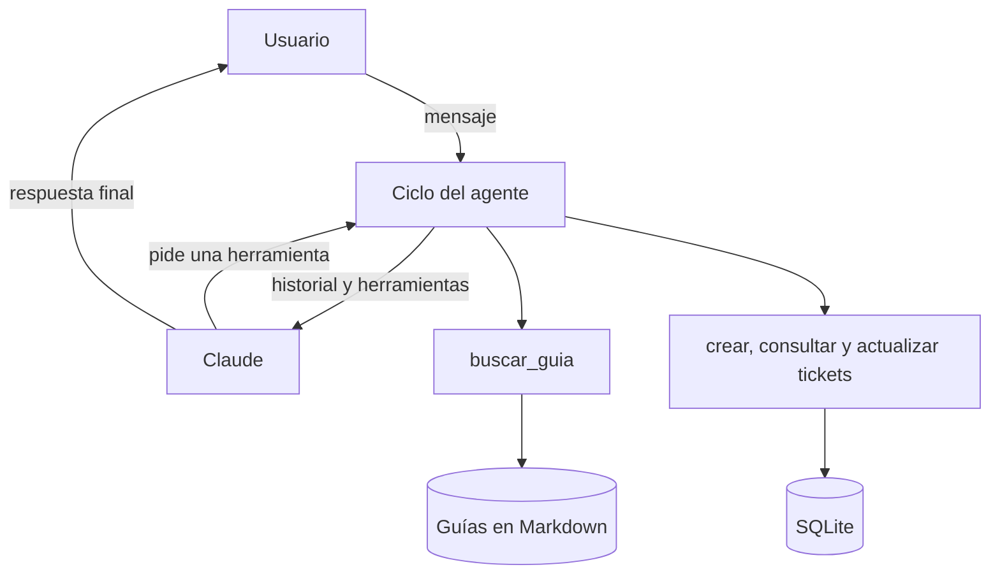

# Agente de soporte para seguridad electrónica

Agente de IA para una mesa de ayuda de cámaras, grabadores, control de acceso y alarmas. Consulta guías técnicas, orienta al usuario paso a paso y, si el problema no se resuelve, crea y escala un ticket.

Lo construí a partir de mi experiencia en soporte de seguridad electrónica: buena parte de los casos se repiten, y un agente puede resolverlos con las guías y dejarle al técnico un ticket con el síntoma y lo que ya se intentó.

## Cómo funciona



Claude decide en cada paso qué herramienta usar. El programa la ejecuta, le devuelve el resultado y repite hasta tener la respuesta final.

| Herramienta | Función |
|---|---|
| `buscar_guia` | Busca procedimientos en las guías técnicas |
| `crear_ticket` | Registra cliente, equipo, síntoma y prioridad |
| `consultar_ticket` | Muestra el estado y las notas de un ticket |
| `actualizar_ticket` | Cambia el estado y deja una nota |

## Tecnologías

Python, API de Claude (SDK oficial de Anthropic), FastAPI, SQLite y pytest.

## Instalación

Necesitas Python 3.10 o superior y una clave de la [API de Claude](https://platform.claude.com/).

```bash
python -m venv .venv
.venv\Scripts\activate
pip install -r requirements.txt
```

Define la clave solo en tu terminal. Nunca la guardes en el código:

```powershell
$env:ANTHROPIC_API_KEY = "tu-clave"
```

## Uso

Chat por consola:

```bash
python -m soporte_agente
```

API REST, con documentación interactiva en `http://127.0.0.1:8000/docs`:

```bash
uvicorn soporte_agente.api:app
```

| Método | Ruta | Función |
|---|---|---|
| POST | `/chat` | Envía un mensaje; `sesion_id` es opcional para continuar una conversación |
| GET | `/tickets` | Lista los tickets |
| GET | `/tickets/{id}` | Muestra un ticket y sus notas |

El modelo se puede cambiar con la variable `MODELO_CLAUDE`.

## Pruebas

```bash
pytest
```

No necesitan clave ni generan costos: usan respuestas simuladas para probar el ciclo del agente, los errores, la base de datos y la API.

## Decisiones de diseño

- **Ciclo propio:** escribí el ciclo del agente en lugar de usar un framework, para controlar y probar cada caso de parada.
- **Límite de pasos:** el agente se detiene después de 10 pasos para evitar ciclos infinitos y gastos inesperados.
- **Errores como información:** si una herramienta falla, Claude recibe el error y puede corregirse, en lugar de romper la conversación.
- **Esquemas estrictos:** las herramientas usan `strict: true`, y los datos se validan otra vez antes de guardarse.
- **SQL parametrizado:** los datos de los tickets nunca se concatenan en una consulta.
- **Búsqueda simple:** la búsqueda es por palabras clave, porque es fácil de explicar y alcanza para pocas guías.

## Limitaciones

- Las guías son ejemplos generales. No incluyen información de ninguna empresa ni reemplazan el manual del fabricante.
- La búsqueda por palabras clave no reconoce sinónimos. Con muchas guías convendría usar embeddings.
- Las sesiones de la API viven en memoria y se pierden al reiniciar.
- La API no tiene autenticación, así que no debe exponerse a internet sin agregarla.
